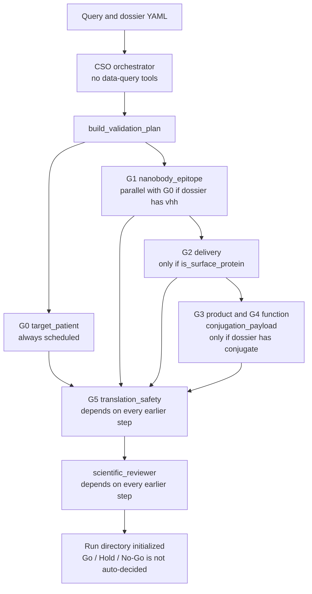

[English](README.md) | 한국어 | [简体中文](README.zh-CN.md)

# SyFlow NDC Go/No-Go 플랫폼

나노바디-약물 접합체 도씨에 한 건씩, 출처를 남기는 Go/Hold/No-Go 결정을 내립니다.

[](LICENSE)
[](environment.yml)
[](https://github.com/mrfeixiang/SyFlow-NDC/actions/workflows/ci.yml)

문서 사이트: <https://mrfeixiang.github.io/SyFlow-NDC/ko/>

작업 단위는 **NDC 후보 도씨에** 한 건입니다. 적응증 × 표면 항원 × VHH 서열 × 접합 부위 × 링커-페이로드 × 제조 배치. 이 플랫폼은 Stanford [Virtual Biotech](https://github.com/harrisongzhang/TheVirtualBiotech)의 검토-감사 패턴을 가져왔습니다.

## 파이프라인

`src/agents/registry.py`의 `AGENT_REGISTRY`에는 에이전트 **일곱** 개가 등록되어 있습니다. `src/schemas/gate.py`의 `GATE_DEFINITIONS`는 게이트 **여섯** 개(G0–G5)를 정의합니다. G3과 G4는 `conjugation_payload`를 공유합니다. CSO는 오케스트레이터(`is_orchestrator: True`)이며 `build_specialist_agents`에서 제외됩니다. 과학 검토자는 읽기 전용(`Read`, `Glob`, `Grep`)입니다.

`python -m src validate`는 모델을 **호출하지 않습니다**. 도씨에를 읽고 계획 DAG를 쓴 다음 `work/<agent>/results/task.md`를 만들고 감사를 기록합니다. `replay`는 아직 구현되지 않았다는 문구를 출력합니다.



체크인된 EGFRvIII, TAK1, RhoA, PNPLA3 도씨에에는 최상위 `conjugate` 키가 없으므로 `validate`는 `conjugation_payload`를 일정에 넣지 않습니다. G3과 G4는 `gate`로 열 수 있으며, 그때 읽는 값은 `GATE_DEFINITIONS`입니다.

| 게이트 | 코드상의 이름 | 담당 에이전트 | No-Go 조건에 포함 |
|---|---|---|---|
| G0 | 표적과 환자 선정 | `target_patient` | 막 접근성 없음. 치료 범위가 성립하기 어려움 |
| G1 | VHH 결합과 선택성 | `nanobody_epitope` | WT 세포에서 선택성 상실. 재현되는 결합 없음 |
| G2 | 내재화와 수송 | `delivery` | 내재화 없음. 수송 구획이 의도한 곳과 다름 |
| G3 | 접합체 정체성과 안정성 | `conjugation_payload` | 불안정하거나 정의가 부족한 제품. 유리 페이로드가 높음 |
| G4 | 항원 의존적 살상 | `conjugation_payload` | 살상이 유리 페이로드를 따르거나 표적 음성 세포에서 일어남 |
| G5 | 노출과 치료 범위 | `translation_safety` | 치료 범위 없음. 허용할 수 없는 신장 독성 |

`src/config/gates.yaml`에는 기준별 메모가 있는 병렬 템플릿이 있습니다. CLI가 쓰는 것은 그 YAML이 아니라 Python 표입니다.

## 기능

- Pydantic 도씨에, 주장, 게이트 스키마 (`src/schemas/`).
- 근거 유형: `prediction`, `literature_evidence`, `retrospective_analysis`, `syflow_wetlab`, `independent_replication`. 습식 실험 필드에는 ELN과 LIMS 배치 ID가 들어갑니다.
- `MANIFEST.json`과 `trace.jsonl`에 대한 주장 검사 (`src/utils/claims.py`).
- SHA-256 산출물 매니페스트, 추가 전용 추적, DAG 계획 검증(순환 검출), 추적에서 재구성하는 출처.
- `audit.json`과 실행 요약을 쓰는 세션 감사 (`src/utils/session_audit.py`).
- `src/mcp_servers/provenance_mcp/server.py`의 출처 MCP 골격. `python scripts/setup_mcp.py`가 `mcp_config.json`을 씁니다. 서버 모듈은 자신을 단순화된 stdio 골격으로 설명합니다.
- `targets/` 아래의 표적별 도씨에와, CLI가 읽는 `src/config/targets.yaml` 표적 레지스트리. 지원하는 `--target` 값은 `pnpla3`, `rhoa`, `tak1`, `egfrviii`입니다.

## 빠른 시작

`environment.yml`은 `syflow-ndc` conda 환경(Python 3.11과 런타임 의존성)을 만듭니다. `syflow`와 `python -m src`가 저장소 루트에서 도씨에 경로를 찾도록 이 저장소를 편집 가능 모드로 설치합니다.

```bash
conda env create -f environment.yml
conda activate syflow-ndc
pip install -e ".[dev]"
cp .env.example .env   # set ANTHROPIC_API_KEY if you later wire a model client
```

슬라이드 생성에는 matplotlib와 python-pptx가 추가로 필요합니다.

```bash
pip install -e ".[slides]"
```

## 사용법

```bash
syflow --help
python -m src --help

python -m src validate --target egfrviii --query "Evaluate EGFRvIII as NDC target for GBM"
python -m src gate --target egfrviii --gate G1 --dossier targets/egfrviii/dossier.yaml
python -m src verify --run-id <RUN_ID>
python -m src replay --run-id <RUN_ID>

python scripts/setup_mcp.py
python scripts/smoke_check.py
```

`validate`와 `gate`는 `SYFLOW_RUNS_DIR`(기본값 `<workspace>/runs`, gitignore 대상) 아래에 `YYYYMMDD_<target>_NNN` 형식의 id로 씁니다. `verify`는 그 디렉터리를 다시 읽고 매니페스트를 재해시하며 출처를 재구성합니다. `replay`는 미구현이라는 메시지를 출력하고 종료합니다.

`scripts/evaluate_egfr_vhh.py`는 하드코딩된 디렉터리 `/home/syslab/Desktop/AIDD SYStem`에서 설계 표를 읽고 `proteinbase_submission/`에 씁니다. 그 설계 입력은 이 저장소에 없습니다. 커밋된 보고서 `proteinbase_submission/evaluation_report.txt`는 후보 49건(PPI-Flow EGFR WT 20, OpenDDE/rfantibody EGFRvIII 19, ForceFlowAb/IgLM EGFRvIII 10)을 기록하고, `select_diverse_top20`의 90% 동일성 필터로 서열 20건을 남깁니다.

```bash
python scripts/create_workflow_ppt.py    # writes figures/ and docs/slides/SyFlow_NDC_Workflow.pptx
python scripts/create_korean_ppt.py      # writes docs/slides/SyFlow_NDC_Workflow_KR.pptx
```

## 표적

아래 분류는 `src/config/targets.yaml`과 각 도씨에에서 가져왔습니다. 게이트 행은 도씨에의 `gate_expectations`이며 측정 결과가 아닙니다.

| 표적 | 도씨에의 적응증 | 표면 단백질 | 도씨에에 기록된 NDC 경로 | CLI `--target` |
|---|---|---|---|---|
| EGFRvIII | GBM, NSCLC, 두경부 SCC | 예 (`is_surface_protein: true`) | 직접 NDC. 단계 `binder_discovery`. 표적 레지스트리의 파일럿 | `egfrviii` |
| TAK1 / MAP3K7 | 염증성 암, AML, 췌장암, KRAS 변이 종양 | 아니오 (세포질 인산화효소) | 간접: 표면 수용체와 TAK1 저해제 페이로드. G0 예상: hold | `tak1` |
| RhoA | RhoA 경로가 활성화된 고형 종양(미만성 위암, T세포 림프종) | 아니오 | 표면 수용체를 통한 간접 경로(EphA2, CXCR4, 또는 인테그린 αvβ3). G0 예상: hold | `rhoa` |
| PNPLA3 | NASH / MAFLD | 아니오 (지질 방울 단백질) | 도씨에 양식은 `small_molecule`. G0 예상: `no_go_for_ndc` | `pnpla3` |

`targets/tnfa/`와 `targets/nk2r/`에는 추가 도씨에가 있습니다. CLI `--target` 선택지는 아닙니다.

## 저장소 구성

```
├── src/
│   ├── cli.py                 # validate, gate, verify, replay
│   ├── __main__.py            # python -m src
│   ├── agents/                # registry plus system prompts
│   ├── schemas/               # dossier, evidence, gates
│   ├── utils/                 # trace, manifest, provenance, plan, audit, claims
│   ├── config/                # gates.yaml (reference), targets.yaml (CLI registry)
│   └── mcp_servers/           # provenance MCP skeleton
├── scripts/
│   ├── setup_mcp.py
│   ├── evaluate_egfr_vhh.py
│   ├── create_workflow_ppt.py
│   ├── create_korean_ppt.py
│   ├── smoke_check.py
│   └── build_pages.py         # README → site/ for GitHub Pages
├── targets/                   # per-target dossier YAML
├── proteinbase_submission/    # committed VHH submission files and evaluation report
├── figures/                   # architecture and workflow PNGs
├── docs/slides/               # English and Korean decks
├── README.md                  # English
├── README.ko.md               # Korean
├── README.zh-CN.md            # Simplified Chinese
├── environment.yml
├── pyproject.toml
└── .claude/skills/            # evidence-citation, run-organization
```

## 그림

`scripts/create_workflow_ppt.py`가 생성합니다 (분야 전문가 다섯, CSO, 검토자).


## 인용

이 소프트웨어를 쓰면 [`CITATION.cff`](CITATION.cff)를 인용해 주세요.

```bibtex
@software{pei_2026_syflow_ndc,
  author       = {Pei, Syang},
  title        = {SyFlow NDC Go/No-Go Platform},
  year         = {2026},
  url          = {https://github.com/mrfeixiang/SyFlow-NDC},
  license      = {MIT}
}
```

## 감사

구조는 Stanford [Virtual Biotech](https://github.com/harrisongzhang/TheVirtualBiotech)의 검토-감사 패턴을 가져왔습니다. 이 저장소의 NDC 게이트 정의, 근거 유형 라벨, 습식 실험 출처 필드는 SyFlow 고유입니다.

## 라이선스

[MIT License](LICENSE)로 공개합니다. Copyright (c) 2026 Syang Pei.

## 런타임 경계와 설치 경로

`src/schemas/gate.py:GATE_DEFINITIONS`가 CLI와 MCP 모두의 현재 런타임 출처입니다.
`src/config/gates.yaml`은 실행되지 않는 참조 템플릿이며, 기준 ID, 트리거, 추가 근거 유형 주석이 Python 표와 다릅니다. 그 주석은 강제되지 않습니다.
별도의 과학 정책 검토 없이 출처를 바꾸지 마세요.

작업 공간은 `SYFLOW_PROJECT_ROOT`가 있으면 그 값이고, 없으면 편집 가능 설치의 소스 체크아웃이며, 휠 설치에서는 현재 작업 디렉터리입니다. `SYFLOW_RUNS_DIR`는 CLI와 MCP 모두에서 쓸 수 있는 실행 위치를 덮어씁니다. 도씨에는 휠에 포함되지 않은 외부 입력입니다. `--dossier /path/to/dossier.yaml`를 쓰거나 `targets/`가 있는 작업 공간을 `SYFLOW_PROJECT_ROOT`로 가리키세요. 입력이 없거나 형식이 잘못되면 실행 디렉터리를 만들기 전에 실패합니다. 표면 표적을 조용히 가정하지 않습니다.

TNF-alpha와 NK2R은 지원 표적 레지스트리 밖에 있습니다. 체크인된 도씨에는 바인더/작용제 캠페인이고 `is_surface_protein`이 없으며, 세포독성 NDC 게이트를 적용하려면 그 양식에 맞춘 합의된 워크플로가 먼저 필요합니다. CLI 선택지만 더하는 것은 검증이 아닙니다.

`validate`와 `gate`는 대기 중인 계획만 초기화합니다. 작업 파일은 실행되지 않은 에이전트가 아니라 CLI 초기화 과정에 귀속됩니다. `verify`는 기록된 산출물의 무결성을 확인하고 기록을 재구성합니다. 과학적 주장을 검증하거나 Go 결정을 승인하지는 않습니다. `replay`, 모델 디스패치, 자동 게이트 평가, 런타임 도구 샌드박스 강제는 구현되어 있지 않습니다. 에이전트 도구 목록과 작업 공간 지시는 설정일 뿐입니다.

MIT 라이선스, 저작권자, 패키지 이름 변경, 게이트 출처 통합, 추가 전문가와 양식 구조는 병합 전에 소유자가 결정할 사항입니다.
