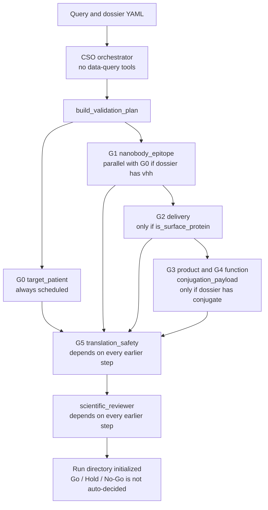
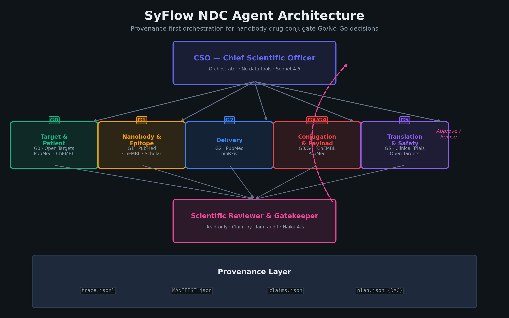
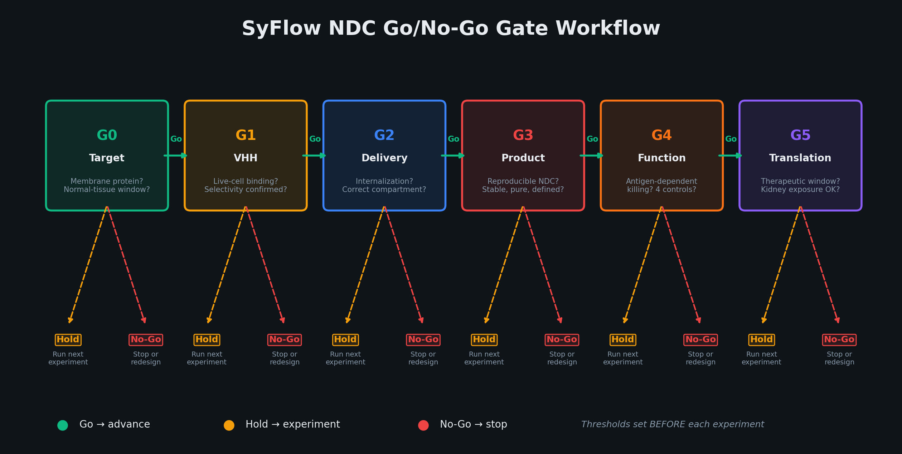
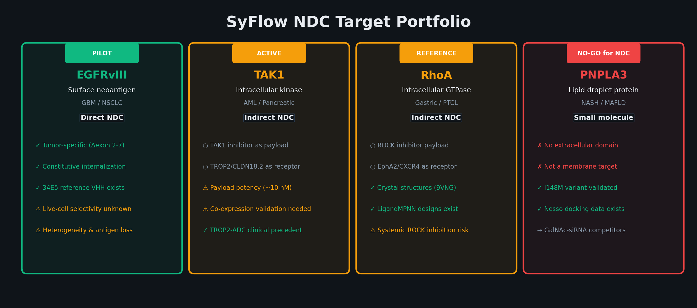
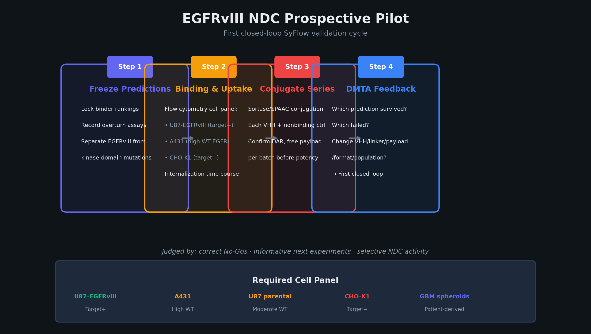

English | [한국어](README.ko.md) | [简体中文](README.zh-CN.md)

# SyFlow NDC Go/No-Go Platform

Provenance-first Go/Hold/No-Go decisions for one nanobody-drug conjugate dossier at a time.

[](LICENSE)
[](environment.yml)
[](https://github.com/mrfeixiang/SyFlow-NDC/actions/workflows/ci.yml)

Documentation site: <https://mrfeixiang.github.io/SyFlow-NDC/>

The unit of work is one **NDC candidate dossier**: indication × surface antigen × VHH sequence × conjugation site × linker-payload × manufacturing batch. The platform adapts the review-and-audit pattern from Stanford's [Virtual Biotech](https://github.com/harrisongzhang/TheVirtualBiotech).

## Pipeline

`AGENT_REGISTRY` in `src/agents/registry.py` registers **seven** agents. `GATE_DEFINITIONS` in `src/schemas/gate.py` defines **six** gates (G0–G5). G3 and G4 share `conjugation_payload`. The CSO is an orchestrator (`is_orchestrator: True`) and is omitted by `build_specialist_agents`. The scientific reviewer is read-only (`Read`, `Glob`, `Grep`).

`python -m src validate` does **not** call a model. It loads the dossier, writes a plan DAG, creates `work/<agent>/results/task.md`, and records an audit. `replay` prints that replay is not implemented.



Checked-in dossiers for EGFRvIII, TAK1, RhoA, and PNPLA3 have no top-level `conjugate` key, so `validate` does not schedule `conjugation_payload`. G3 and G4 can still be opened with `gate`, which reads `GATE_DEFINITIONS`.

| Gate | Name in code | Primary agent | No-Go triggers include |
|---|---|---|---|
| G0 | Target and Patient Selection | `target_patient` | No membrane accessibility; therapeutic window implausible |
| G1 | VHH Binding and Selectivity | `nanobody_epitope` | Selectivity lost on WT cells; no reproducible binding |
| G2 | Internalization and Trafficking | `delivery` | No internalization; wrong trafficking compartment |
| G3 | Conjugate Identity and Stability | `conjugation_payload` | Unstable or poorly defined product; high free payload |
| G4 | Antigen-Dependent Killing | `conjugation_payload` | Killing tracks free payload or target-negative cells |
| G5 | Exposure and Therapeutic Window | `translation_safety` | No therapeutic window; unacceptable kidney toxicity |

A parallel template with per-criterion notes lives in `src/config/gates.yaml`. The CLI uses the Python table, not that YAML file.

## Features

- Pydantic dossier, claim, and gate schemas (`src/schemas/`).
- Evidence types: `prediction`, `literature_evidence`, `retrospective_analysis`, `syflow_wetlab`, `independent_replication`. Wet-lab fields include ELN and LIMS batch IDs.
- Claim checks against `MANIFEST.json` and `trace.jsonl` (`src/utils/claims.py`).
- SHA-256 artifact manifest, append-only trace, DAG plan validation (cycle detection), and provenance reconstructed from the trace.
- Session audit that writes `audit.json` and a run summary (`src/utils/session_audit.py`).
- Provenance MCP skeleton at `src/mcp_servers/provenance_mcp/server.py`. `python scripts/setup_mcp.py` writes `mcp_config.json`. The server module documents itself as a simplified stdio skeleton.
- Per-target dossiers under `targets/`, plus a target registry in `src/config/targets.yaml` loaded by the CLI. Supported `--target` choices are: `pnpla3`, `rhoa`, `tak1`, `egfrviii`.

## Quickstart

`environment.yml` creates the `syflow-ndc` conda environment (Python 3.11 and the runtime dependencies). Install this repository in editable mode so the `syflow` command and `python -m src` resolve dossier paths from the repo root.

```bash
conda env create -f environment.yml
conda activate syflow-ndc
pip install -e ".[dev]"
cp .env.example .env   # set ANTHROPIC_API_KEY if you later wire a model client
```

Slide builders additionally need matplotlib and python-pptx:

```bash
pip install -e ".[slides]"
```

## Usage

```bash
syflow --help
python -m src --help

python -m src validate --target egfrviii --query "Evaluate EGFRvIII as NDC target for GBM"
python -m src gate --target egfrviii --gate G1 --dossier targets/egfrviii/dossier.yaml
python -m src verify --run-id <RUN_ID>
python -m src replay --run-id <RUN_ID>

python scripts/setup_mcp.py
python scripts/smoke_check.py
```

`validate` and `gate` write under `SYFLOW_RUNS_DIR` (default `<workspace>/runs`, gitignored) using ids `YYYYMMDD_<target>_NNN`. `verify` reloads that directory, re-hashes the manifest, and reconstructs provenance. `replay` exits after printing that it is not implemented.

`scripts/evaluate_egfr_vhh.py` reads design tables from the hard-coded directory `/home/syslab/Desktop/AIDD SYStem` and writes `proteinbase_submission/`. Those design inputs are not in this repository. The committed report `proteinbase_submission/evaluation_report.txt` records 49 candidates loaded (20 PPI-Flow EGFR WT, 19 OpenDDE/rfantibody EGFRvIII, 10 ForceFlowAb/IgLM EGFRvIII) and 20 sequences kept by the 90% identity filter in `select_diverse_top20`.

```bash
python scripts/create_workflow_ppt.py    # writes figures/ and docs/slides/SyFlow_NDC_Workflow.pptx
python scripts/create_korean_ppt.py      # writes docs/slides/SyFlow_NDC_Workflow_KR.pptx
```

## Targets

Classifications below are taken from `src/config/targets.yaml` and each dossier. Gate rows are dossier `gate_expectations`, not measured outcomes.

| Target | Indication in the dossier | Surface protein | NDC path recorded in the dossier | CLI `--target` |
|---|---|---|---|---|
| EGFRvIII | GBM, NSCLC, head and neck SCC | Yes (`is_surface_protein: true`) | Direct NDC; stage `binder_discovery`; pilot in the target registry | `egfrviii` |
| TAK1 / MAP3K7 | Inflammatory cancers, AML, pancreatic cancer, KRAS-mutant tumors | No (cytoplasmic kinase) | Indirect: surface receptor plus a TAK1-inhibitor payload. G0 expectation: hold | `tak1` |
| RhoA | Solid tumors with RhoA pathway activation (diffuse gastric, T-cell lymphoma) | No | Indirect via a surface receptor (EphA2, CXCR4, or integrin αvβ3). G0 expectation: hold | `rhoa` |
| PNPLA3 | NASH / MAFLD | No (lipid-droplet protein) | Dossier modality is `small_molecule`. G0 expectation: `no_go_for_ndc` | `pnpla3` |

`targets/tnfa/` and `targets/nk2r/` contain additional dossiers. They are not CLI `--target` choices.

## Repository layout

```
├── src/
│   ├── cli.py                 # validate, gate, verify, replay
│   ├── __main__.py            # python -m src
│   ├── agents/                # registry plus system prompts
│   ├── schemas/               # dossier, evidence, gates
│   ├── utils/                 # trace, manifest, provenance, plan, audit, claims
│   ├── config/                # gates.yaml (reference), targets.yaml (CLI registry)
│   └── mcp_servers/           # provenance MCP skeleton
├── scripts/
│   ├── setup_mcp.py
│   ├── evaluate_egfr_vhh.py
│   ├── create_workflow_ppt.py
│   ├── create_korean_ppt.py
│   ├── smoke_check.py
│   └── build_pages.py         # README → site/ for GitHub Pages
├── targets/                   # per-target dossier YAML
├── proteinbase_submission/    # committed VHH submission files and evaluation report
├── figures/                   # architecture and workflow PNGs
├── docs/slides/               # English and Korean decks
├── README.md                  # English
├── README.ko.md               # Korean
├── README.zh-CN.md            # Simplified Chinese
├── environment.yml
├── pyproject.toml
└── .claude/skills/            # evidence-citation, run-organization
```

## Figures

Generated by `scripts/create_workflow_ppt.py` (five domain specialists, CSO, reviewer).









## Citation

If you use this software, cite [`CITATION.cff`](CITATION.cff).

```bibtex
@software{pei_2026_syflow_ndc,
  author       = {Pei, Syang},
  title        = {SyFlow NDC Go/No-Go Platform},
  year         = {2026},
  url          = {https://github.com/mrfeixiang/SyFlow-NDC},
  license      = {MIT}
}
```

## Acknowledgements

Architecture adapted from Stanford's [Virtual Biotech](https://github.com/harrisongzhang/TheVirtualBiotech) review-and-audit pattern. NDC gate definitions, the evidence-type labels, and wet-lab provenance fields in this repository are SyFlow-specific.

## License

Released under the [MIT License](LICENSE). Copyright (c) 2026 Syang Pei.

## Runtime boundaries and installed paths

`src/schemas/gate.py:GATE_DEFINITIONS` is the current runtime source for both CLI and MCP.
`src/config/gates.yaml` is a non-executable reference template with differing criterion IDs,
triggers and additional evidence-type annotations. Those annotations are not enforced.
Do not switch sources without a separate scientific policy review.

The workspace is `SYFLOW_PROJECT_ROOT` when set, otherwise the source checkout for editable
installs, otherwise the current working directory for wheel installs. `SYFLOW_RUNS_DIR`
overrides the writable run location for both CLI and MCP. Dossiers are external inputs,
not bundled in the wheel: use `--dossier /path/to/dossier.yaml` or point
`SYFLOW_PROJECT_ROOT` at a workspace containing `targets/`. Missing or malformed inputs fail
before creating a run; they no longer silently assume a surface target.

TNF-alpha and NK2R remain outside the supported target registry: their checked-in dossiers
are binder/agonist campaigns, lack `is_surface_protein`, and need an agreed modality-specific
workflow before applying cytotoxic NDC gates. Adding a CLI choice alone is not validation.

`validate` and `gate` initialize pending plans only. Task files are attributed to the CLI
initializer, not to agents that never ran. `verify` checks recorded artifact integrity and
reconstructs records; it does not validate scientific claims or authorize a Go decision.
`replay`, model dispatch, automatic gate evaluation and runtime tool sandbox enforcement
are not implemented. Agent tool lists and workspace instructions are configuration only.

MIT licensing, copyright holder, package renaming, gate-source unification and additional
specialist/modality architecture remain owner decisions before merge.
