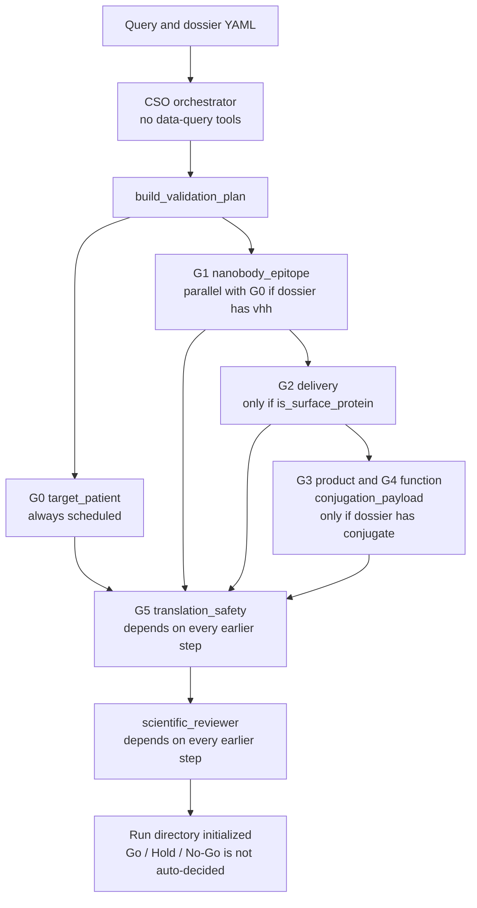

[English](README.md) | [한국어](README.ko.md) | 简体中文

# SyFlow NDC Go/No-Go 平台

一次只对一份纳米抗体-药物偶联物档案做出可追溯的 Go/Hold/No-Go 决定。

[](LICENSE)
[](environment.yml)
[](https://github.com/mrfeixiang/SyFlow-NDC/actions/workflows/ci.yml)

文档站点：<https://mrfeixiang.github.io/SyFlow-NDC/zh/>

工作单元是一份 **NDC 候选档案**：适应症 × 表面抗原 × VHH 序列 × 偶联位点 × 连接子-载荷 × 生产批次。本平台沿用斯坦福 [Virtual Biotech](https://github.com/harrisongzhang/TheVirtualBiotech) 的审阅与审计模式。

## 流程

`src/agents/registry.py` 中的 `AGENT_REGISTRY` 注册了 **七个** 智能体。`src/schemas/gate.py` 中的 `GATE_DEFINITIONS` 定义了 **六个** 闸门（G0–G5）。G3 与 G4 共用 `conjugation_payload`。CSO 是编排者（`is_orchestrator: True`），`build_specialist_agents` 不会调度它。科学审阅者只读（`Read`、`Glob`、`Grep`）。

`python -m src validate` **不会**调用模型。它读取档案、写入计划 DAG、创建 `work/<agent>/results/task.md`，并记录审计。`replay` 会打印尚未实现。



已入库的 EGFRvIII、TAK1、RhoA、PNPLA3 档案没有顶层 `conjugate` 键，因此 `validate` 不会安排 `conjugation_payload`。仍可用 `gate` 打开 G3 和 G4，读取的是 `GATE_DEFINITIONS`。

| 闸门 | 代码中的名称 | 主要智能体 | No-Go 触发条件包括 |
|---|---|---|---|
| G0 | 靶点与患者选择 | `target_patient` | 无膜可及性；治疗窗难以成立 |
| G1 | VHH 结合与选择性 | `nanobody_epitope` | 在野生型细胞上失去选择性；没有可重复的结合 |
| G2 | 内化与转运 | `delivery` | 无内化；转运区室不符合预期 |
| G3 | 偶联物身份与稳定性 | `conjugation_payload` | 产物不稳定或定义不清；游离载荷过高 |
| G4 | 抗原依赖性杀伤 | `conjugation_payload` | 杀伤跟随游离载荷，或出现在靶点阴性细胞中 |
| G5 | 暴露与治疗窗 | `translation_safety` | 没有治疗窗；不可接受的肾毒性 |

`src/config/gates.yaml` 是一份带逐条注释的平行模板。CLI 使用的是 Python 表，而不是这份 YAML。

## 功能

- Pydantic 档案、主张与闸门模式（`src/schemas/`）。
- 证据类型：`prediction`、`literature_evidence`、`retrospective_analysis`、`syflow_wetlab`、`independent_replication`。湿实验字段包含 ELN 与 LIMS 批次 ID。
- 对照 `MANIFEST.json` 与 `trace.jsonl` 检查主张（`src/utils/claims.py`）。
- SHA-256 产物清单、只追加的追踪、DAG 计划校验（环检测），以及从追踪重建的来源。
- 写入 `audit.json` 和运行摘要的会话审计（`src/utils/session_audit.py`）。
- `src/mcp_servers/provenance_mcp/server.py` 中的来源 MCP 骨架。`python scripts/setup_mcp.py` 会写出 `mcp_config.json`。该服务器模块把自己说明为简化的 stdio 骨架。
- `targets/` 下的各靶点档案，以及 CLI 会加载的 `src/config/targets.yaml` 靶点登记。支持的 `--target` 取值为 `pnpla3`、`rhoa`、`tak1`、`egfrviii`。

## 快速开始

`environment.yml` 会创建 `syflow-ndc` conda 环境（Python 3.11 及运行时依赖）。请以可编辑方式安装本仓库，这样 `syflow` 和 `python -m src` 会从仓库根目录解析档案路径。

```bash
conda env create -f environment.yml
conda activate syflow-ndc
pip install -e ".[dev]"
cp .env.example .env   # set ANTHROPIC_API_KEY if you later wire a model client
```

幻灯片脚本还需要 matplotlib 和 python-pptx：

```bash
pip install -e ".[slides]"
```

## 用法

```bash
syflow --help
python -m src --help

python -m src validate --target egfrviii --query "Evaluate EGFRvIII as NDC target for GBM"
python -m src gate --target egfrviii --gate G1 --dossier targets/egfrviii/dossier.yaml
python -m src verify --run-id <RUN_ID>
python -m src replay --run-id <RUN_ID>

python scripts/setup_mcp.py
python scripts/smoke_check.py
```

`validate` 和 `gate` 写入 `SYFLOW_RUNS_DIR`（默认 `<workspace>/runs`，已被 gitignore），编号为 `YYYYMMDD_<target>_NNN`。`verify` 重新加载该目录、重新计算清单哈希并重建来源。`replay` 打印尚未实现后退出。

`scripts/evaluate_egfr_vhh.py` 从硬编码目录 `/home/syslab/Desktop/AIDD SYStem` 读取设计表，并写入 `proteinbase_submission/`。这些设计输入不在本仓库中。已提交的报告 `proteinbase_submission/evaluation_report.txt` 记录了 49 个候选（PPI-Flow EGFR WT 20 个，OpenDDE/rfantibody EGFRvIII 19 个，ForceFlowAb/IgLM EGFRvIII 10 个），并由 `select_diverse_top20` 的 90% 一致性过滤保留 20 条序列。

```bash
python scripts/create_workflow_ppt.py    # writes figures/ and docs/slides/SyFlow_NDC_Workflow.pptx
python scripts/create_korean_ppt.py      # writes docs/slides/SyFlow_NDC_Workflow_KR.pptx
```

## 靶点

下表分类来自 `src/config/targets.yaml` 和各档案。闸门行是档案中的 `gate_expectations`，不是实测结果。

| 靶点 | 档案中的适应症 | 表面蛋白 | 档案记录的 NDC 路径 | CLI `--target` |
|---|---|---|---|---|
| EGFRvIII | GBM、NSCLC、头颈 SCC | 是（`is_surface_protein: true`） | 直接 NDC；阶段 `binder_discovery`；靶点登记中的试点 | `egfrviii` |
| TAK1 / MAP3K7 | 炎症相关肿瘤、AML、胰腺癌、KRAS 突变肿瘤 | 否（胞质激酶） | 间接：表面受体加上 TAK1 抑制剂载荷。G0 预期：hold | `tak1` |
| RhoA | RhoA 通路激活的实体瘤（弥漫性胃癌、T 细胞淋巴瘤） | 否 | 经表面受体的间接路径（EphA2、CXCR4 或整合素 αvβ3）。G0 预期：hold | `rhoa` |
| PNPLA3 | NASH / MAFLD | 否（脂滴蛋白） | 档案模态为 `small_molecule`。G0 预期：`no_go_for_ndc` | `pnpla3` |

`targets/tnfa/` 和 `targets/nk2r/` 还有其他档案。它们不是 CLI 的 `--target` 选项。

## 仓库结构

```
├── src/
│   ├── cli.py                 # validate, gate, verify, replay
│   ├── __main__.py            # python -m src
│   ├── agents/                # registry plus system prompts
│   ├── schemas/               # dossier, evidence, gates
│   ├── utils/                 # trace, manifest, provenance, plan, audit, claims
│   ├── config/                # gates.yaml (reference), targets.yaml (CLI registry)
│   └── mcp_servers/           # provenance MCP skeleton
├── scripts/
│   ├── setup_mcp.py
│   ├── evaluate_egfr_vhh.py
│   ├── create_workflow_ppt.py
│   ├── create_korean_ppt.py
│   ├── smoke_check.py
│   └── build_pages.py         # README → site/ for GitHub Pages
├── targets/                   # per-target dossier YAML
├── proteinbase_submission/    # committed VHH submission files and evaluation report
├── figures/                   # architecture and workflow PNGs
├── docs/slides/               # English and Korean decks
├── README.md                  # English
├── README.ko.md               # Korean
├── README.zh-CN.md            # Simplified Chinese
├── environment.yml
├── pyproject.toml
└── .claude/skills/            # evidence-citation, run-organization
```

## 图

由 `scripts/create_workflow_ppt.py` 生成（五名领域专家、CSO、审阅者）。


## 引用

如果使用本软件，请引用 [`CITATION.cff`](CITATION.cff)。

```bibtex
@software{pei_2026_syflow_ndc,
  author       = {Pei, Syang},
  title        = {SyFlow NDC Go/No-Go Platform},
  year         = {2026},
  url          = {https://github.com/mrfeixiang/SyFlow-NDC},
  license      = {MIT}
}
```

## 致谢

架构改编自斯坦福 [Virtual Biotech](https://github.com/harrisongzhang/TheVirtualBiotech) 的审阅与审计模式。本仓库中的 NDC 闸门定义、证据类型标签和湿实验来源字段是 SyFlow 自己的。

## 许可证

以 [MIT License](LICENSE) 发布。Copyright (c) 2026 Syang Pei。

## 运行时边界与安装路径

`src/schemas/gate.py:GATE_DEFINITIONS` 是 CLI 和 MCP 当前的运行时来源。
`src/config/gates.yaml` 是不可执行的参考模板，其标准 ID、触发条件和额外的证据类型注释与 Python 表不同。这些注释不会被强制执行。
没有单独的科学政策审阅，不要更换来源。

工作区在设置了 `SYFLOW_PROJECT_ROOT` 时使用该值；否则，可编辑安装使用源代码检出目录，wheel 安装使用当前工作目录。`SYFLOW_RUNS_DIR` 会同时覆盖 CLI 和 MCP 的可写运行位置。档案是外部输入，不打进 wheel：使用 `--dossier /path/to/dossier.yaml`，或把 `SYFLOW_PROJECT_ROOT` 指到含有 `targets/` 的工作区。缺失或格式错误的输入会在创建运行目录之前失败，不再默认把它当成表面靶点。

TNF-alpha 和 NK2R 仍在受支持的靶点登记之外：已入库的档案是结合物/激动剂项目，没有 `is_surface_protein`，在套用细胞毒性 NDC 闸门之前需要先约定该模态自己的流程。只增加一个 CLI 选项并不构成验证。

`validate` 和 `gate` 只初始化待执行的计划。任务文件归属于 CLI 初始化过程，而不是从未运行的智能体。`verify` 检查已记录产物的完整性并重建记录；它不验证科学主张，也不批准 Go 决定。`replay`、模型调度、自动闸门评估和运行时工具沙箱都尚未实现。智能体工具列表和工作区说明只是配置。

MIT 许可、版权人、包重命名、闸门来源统一，以及额外的专家或模态架构，都是合并前由仓库所有者决定的事项。
